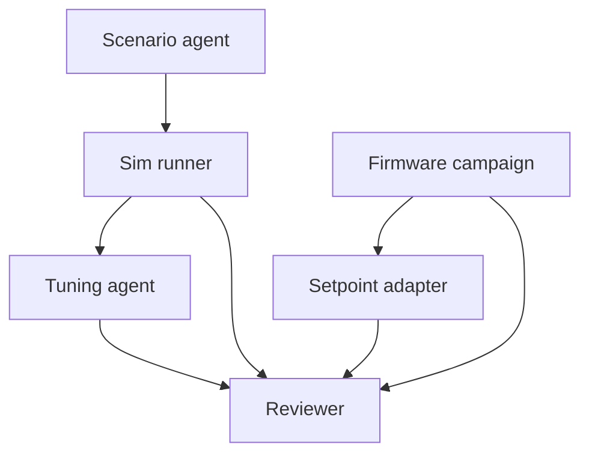
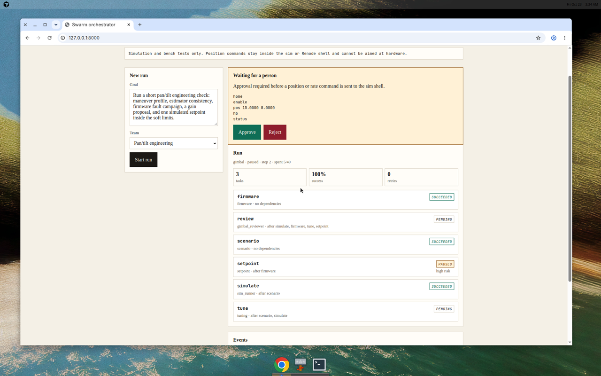
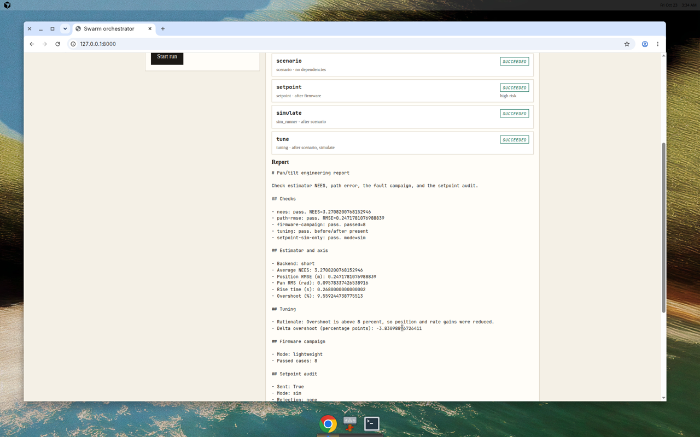

# Asynchronous multi-agent swarm orchestrator

A coordinator turns a goal into a DAG, Redis Streams hand the tasks to workers, and a person has to approve anything that would move a pan/tilt positioner. The default model is a deterministic mock, so tests, CI, and the demo run with no API key.

The flagship team is a **pan/tilt engineering bench**: it writes a maneuver profile, measures estimator NEES and axis error, runs a firmware fault campaign, proposes PID changes, and only then asks a person before sending a setpoint to a sim or Renode shell. It does not select anything to point at, and it will not talk to a physical board.

## Architecture

```mermaid
flowchart LR
  user["Goal"] --> api["FastAPI"]
  api --> graph["LangGraph coordinator"]
  graph --> guard["Guardrails"]
  guard --> stream["Redis Streams"]
  stream --> workers["Worker agents"]
  workers --> results["Results and inbox"]
  results --> graph
  graph --> hitl["Pause for approval"]
  hitl --> api
  workers --> metrics["Latency, retries, success"]
```

The graph is the policy. Nodes plan the DAG, check the guardrails, queue ready tasks, fold results back in, and stop on a pause, a failure, or a finished run. Workers are replaceable processes. A task message stays pending in the consumer group until the worker acknowledges it, so a crash mid-task is a reclaim rather than a lost job.

Checkpoints are a JSON blob per run in Redis. After a restart the API reloads any run that was still `running` and continues from the last phase. A paused run stays paused until the same breakpoint is approved or rejected.

### Guardrails

| Guard | Default | What it does |
| --- | --- | --- |
| Max steps | 24 | Stops a coordinator that keeps waking up |
| Loop detection | same signature 3 times | Stops when results and in-flight work stop changing |
| Deadlock | cyclic or unsatisfiable dependencies | Fails the run instead of spinning |
| Per-task timeout | 10s | Counts as a failed attempt |
| Attempts | 3 | Then the task is dead-lettered |
| Budget | 40 | Plan plus each queued task spends 1 |

### Messaging

Redis Streams, not an in-memory queue:

- `swarm:tasks` with consumer group `workers`
- `swarm:dlq` for attempts that are used up
- `swarm:events:{run}` for the SSE log
- `swarm:checkpoint:{run}` for resume
- a set-once result key so a redelivery cannot apply a task twice
- a staged-approval key for human breakpoints, which is not a terminal result

Retries use equal-jitter exponential backoff. An HTTP 429, including from the OpenAI-compatible client, honors `Retry-After` when it is larger than the backoff.

## Pan/tilt engineering team



Scenario and the firmware campaign start together. The setpoint task always pauses for a person. Tuning and the review wait until the tasks they depend on have a terminal result. Rejecting the setpoint still produces a report, and no shell bytes are written.

| Agent | Job |
| --- | --- |
| Scenario | Writes a maneuver YAML: straight, coordinated turn, speed change, optional weave. Durations and turn rate are clamped. |
| Sim runner | Short in-process plant and constant-velocity filter. Reports NEES, position RMSE, rise, overshoot. Optional native binaries if a checkout is built. |
| Firmware | Eight fault cases: enable-before-home, soft limit, keep-out, an accepted move, e-stop latch, heartbeat loss, overcurrent, stall. Parses gtest or Renode output when those trees exist. |
| Tuning | If overshoot is above 8%, lowers the position and rate gains, re-runs the short Monte Carlo, and reports the delta. Gains are clamped. |
| Setpoint | Builds `home`, `enable`, `pos` or `rate`, `hb`, `status`. Sends them only after approval, and only in `sim` or `renode`. |
| Reviewer | Checks the numbers and writes the report. |

Pinned upstream checkouts, not vendored source:

| Repo | SHA | What this project will run |
| --- | --- | --- |
| [gimbal-tracker-ros2](https://github.com/gambrelcolby63/gimbal-tracker-ros2) | `92632eea57fa913c08ccc6e01d7ce06755054f0e` | `step_response` and `estimator_mc` only, when `SWARM_GIMBAL_BACKEND=native` and the binaries are already built |
| [stm32-motor-safety-fw](https://github.com/gambrelcolby63/stm32-motor-safety-fw) | `6da56d819b3149ebc586cea80c8566f7fb31f904` | `ctest` in `build/host` and `renode-test`, when `STM32_FW_ROOT` points at a built tree |

`scripts/fetch_pins.sh` clones those SHAs under `third_party/`. CI does not. The lightweight campaign follows the firmware's documented shell and travel limits: pan −170° to +170°, tilt −45° to +90°, pan rate 120 °/s, tilt rate 80 °/s. A keep-out rectangle rejects a segment that enters it. Approval cannot widen a limit or clear a zone, and `SWARM_UART_MODE=hardware` disables the adapter before any byte is sent.

## Failure modes

| Failure | How it is detected | What happens |
| --- | --- | --- |
| Worker dies mid-task | Message stays pending; idle time passes the visibility timeout | Another worker reclaims it. The result key makes the second delivery a no-op if the first one already finished. |
| HTTP 429 or injected rate limit | `RateLimitError` or status 429 | Sleep for backoff-with-jitter, or `Retry-After` if that is longer, then a new attempt id. |
| Attempt budget used up | `attempt >= max_attempts` | Record on `swarm:dlq`, task status `dlq`, run fails if a required task died. |
| Process restart | Checkpoint hash | API startup resumes `running` runs. `paused` runs wait. |
| Planner or dispatcher loop | Same progress fingerprint three times, or max steps | Run fails with `loop_detected` or `max_steps`. |
| Cyclic DAG | Nothing is ready and nothing is in flight | Run fails with `deadlock`. |
| Budget exceeded | Spent cost would pass the cap | Run fails with `budget` and the over-budget tasks are not queued. |
| Hung task | Worker or engine timeout | Retry, then dead-letter. |
| Low confidence | Worker confidence below 0.75 | Run pauses. Approve accepts the result. Reject marks it `rejected`. |
| High-risk setpoint | The adapter is about to write a position or rate line | Always pauses. Reject sends nothing. Approve still re-checks limits, zones, and mode. |
| Real hardware | `SWARM_UART_MODE` is not `sim` or `renode` | The tool is disabled. Approval cannot enable it. |
| Duplicate delivery | Delivery id and result key | Second enqueue is ignored. Second execution acknowledges the existing result. |

## How to run

Python 3.11+.

```sh
pip install -e ".[dev]"
pytest
python scripts/demo_run.py --output docs/samples
```

The demo uses the mock model and the short simulator. It writes `docs/samples/gimbal_trace.json`, `gimbal_dag.md`, and `gimbal_report.md`. A checked-in sample is already in that directory. One sample run reported average NEES about 3.27, position RMSE about 0.25 m, and a gain change that cut overshoot by about 3.8 percentage points. The shell log is `home`, `enable`, `pos 15 8`, `hb`, `status`, and it is empty until the breakpoint is approved.

API and dashboard, with Redis on localhost:

```sh
redis-server --daemonize yes --bind 127.0.0.1 --port 6379
REDIS_URL=redis://127.0.0.1:6379/0 python -m swarm_orchestrator.api
```

Open `http://127.0.0.1:8000`. Submit a goal, watch the DAG, and approve or reject the breakpoint. Events are also available as SSE at `/api/runs/{id}/events`.

| Method | Path | Purpose |
| --- | --- | --- |
| `POST` | `/api/runs` | `{ "goal", "team": "generic" or "gimbal", "wait": false }` |
| `GET` | `/api/runs/{id}` | Status, DAG nodes, pause, metrics, report |
| `GET` | `/api/runs/{id}/dag` | Mermaid diagram |
| `GET` | `/api/runs/{id}/events` | Server-sent events. `once=1` replays and closes. |
| `POST` | `/api/runs/{id}/breakpoints/{bp}` | `{ "decision": "approve" or "reject", "note", "wait" }` |
| `GET` | `/api/metrics` | Latency, retries, success rate across runs |

Docker Compose runs Redis, the API, and a separate worker so a dead worker is a different process from the coordinator:

```sh
docker compose up --build
```

GitHub Codespaces uses `.devcontainer`. On start it brings up Redis and the API with workers inside the API process, and forwards port 8000. That is the path that works from a phone: open the forwarded port, run the pan/tilt goal, approve the setpoint.

### Environment

| Variable | Default | Role |
| --- | --- | --- |
| `SWARM_LLM` | `mock` | `mock` or `openai` |
| `OPENAI_BASE_URL` | OpenAI v1 | Any compatible chat endpoint |
| `OPENAI_API_KEY` | empty | Required only when `SWARM_LLM=openai` |
| `OPENAI_MODEL` | `gpt-4o-mini` | Model name |
| `REDIS_URL` | `redis://localhost:6379/0` | Broker and checkpoints |
| `SWARM_EMBEDDED_WORKERS` | `1` | `0` when a separate worker process consumes the stream |
| `SWARM_MAX_STEPS` | `24` | Coordinator step cap |
| `SWARM_BUDGET` | `40` | Cost cap |
| `SWARM_CONFIDENCE_THRESHOLD` | `0.75` | Pause below this |
| `SWARM_TASK_TIMEOUT_S` | `10` | Per attempt |
| `SWARM_MAX_ATTEMPTS` | `3` | Includes the first try |
| `SWARM_GIMBAL_BACKEND` | `short` | `short` in CI. `native` runs built `step_response` and `estimator_mc`. |
| `GIMBAL_TRACKER_ROOT` | empty | Checkout root for the native backend |
| `STM32_FW_ROOT` | empty | Checkout root for host and Renode tests |
| `SWARM_UART_MODE` | `sim` | `sim`, `renode`, or anything else to disable |
| `SWARM_RENODE_UART` | empty | Optional `host:port` line socket. Otherwise Renode mode uses the in-process shell. |

A goal can ask for a bench pose, for example `pan=15 tilt=8`. Values outside the soft limits or inside a keep-out zone still pause, and the adapter refuses to send them.

## Tests

```sh
pytest
```

Unit tests cover backoff, loop fingerprints, the OpenAI-compatible 429 client, keep-out geometry, scenario validation, the short filter, the fault campaign, and the UART adapter. Integration tests run the generic team and the pan/tilt team through the graph, including approve, reject, budget, step cap, deadlock, and checkpoint resume. Chaos tests inject a crash before acknowledge, a crash after the result is stored, two rate limits, and a dead-letter. When `REDIS_URL` points at Redis, one test SIGKILLs a worker subprocess mid-task and checks that a second worker finishes it. CI sets that variable and also runs `scripts/demo_run.py`.

## Demo

The dashboard below is the real API with the mock model. The pause shows the shell lines before anything is sent. After approval the report includes NEES, RMSE, the fault campaign, and the setpoint audit.





Sample artifacts from `python scripts/demo_run.py`:

- [trace](docs/samples/gimbal_trace.json)
- [DAG](docs/samples/gimbal_dag.md)
- [report](docs/samples/gimbal_report.md)

## What I learned

This section is for the person who owns the repository. Leave the prompts and fill them in after running the demo, killing a worker, and rejecting a setpoint.

- The bug that took the longest to find:
- What the chaos tests caught that the happy path did not:
- What I would change about the approval boundary:
- What broke when a worker died mid-task:
- What I would keep if I rewrote the coordinator:
